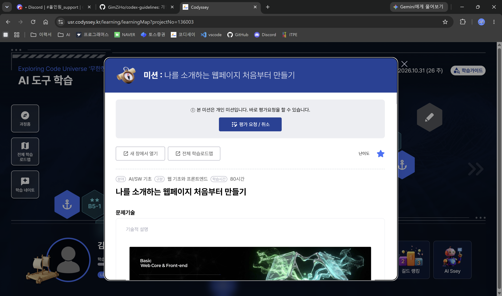
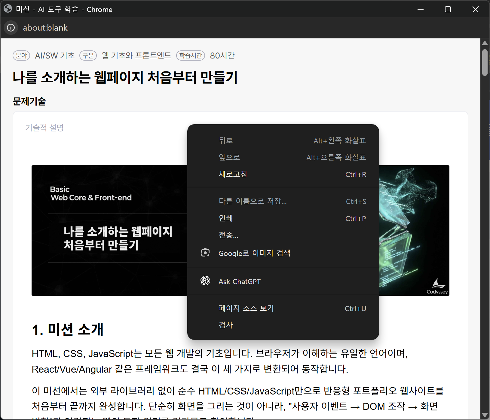
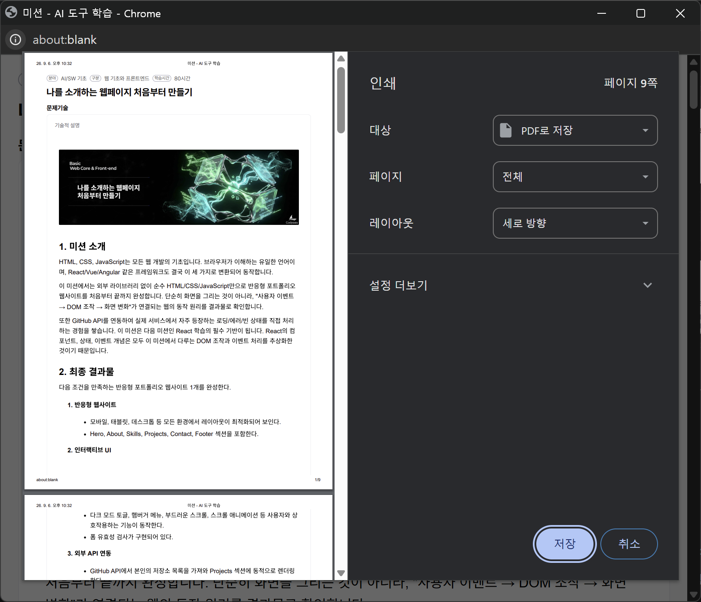

# 과제 요구사항 PDF 다운로드

코디세이 플랫폼의 과제 요구사항을 파일로 보관하고 싶을 때, 과제 화면을 새 창으로 열어 브라우저의 인쇄 기능으로 PDF를 저장할 수 있습니다.

첫 과제를 진행하며 직접 확인한 방법입니다. 아래 설명과 캡처는 2026년 9월 6일 Windows의 Chrome 화면을 기준으로 합니다.

## 1. 과제를 새 창에서 열기

코디세이 플랫폼에서 저장할 과제의 상세 화면을 열고 **새 창에서 열기** 버튼을 누릅니다.

## 2. 우클릭 메뉴에서 인쇄 선택하기

과제 내용이 별도 창으로 열리면 페이지 안에서 마우스 오른쪽 버튼을 누르고 **인쇄**를 선택합니다.

## 3. PDF로 저장하기

인쇄 창에서 **대상**을 **PDF로 저장**으로 선택합니다. 과제 전체를 저장하려면 **페이지**를 **전체**로 설정하고, 미리보기에서 내용을 확인합니다.

오른쪽 아래 **저장** 버튼을 누른 뒤 파일 이름과 저장 위치를 지정하면 PDF 파일로 저장됩니다.

[README로 돌아가기](../../README.md)
